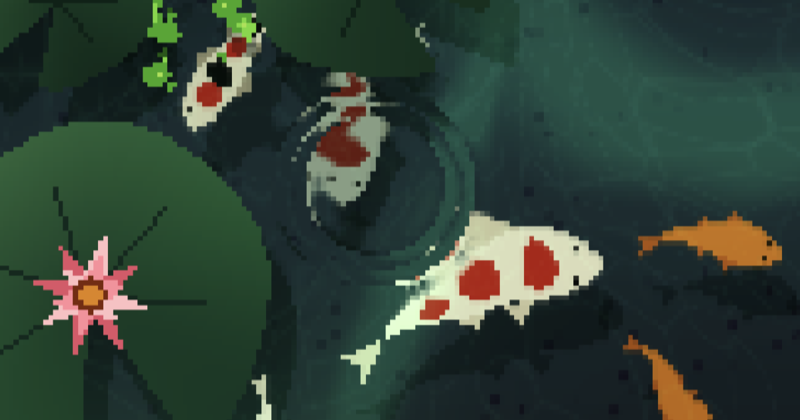

# 🎏 Nagomi Koi Pond — Interactive 3D Live Wallpaper

<div align="center">



### Procedural Hydrodynamic Koi Simulation for Wallpaper Engine & Lively Wallpaper

[](https://threejs.org/)
[](https://www.typescriptlang.org/)
[]()
[]()
[]()
[](./LICENSE)

*A procedural 3D aquatic desktop wallpaper featuring real-time shallow water wave simulation, biomechanical spine kinematics, frosted glassmorphism pond clock, artisanal pixel boat with bow anchor and twin-track wake ribbons, lively pond fauna, audio-reactive gramophone, proximity feeding, and 14 mythical koi mutations.*

[Features](#-key-features) • [Installation](#-installation-guide) • [Math & Physics](#-mathematical--computational-model) • [Development](#-development--scripts)

</div>

---

## 🌟 Key Features

### 🌊 Hydrodynamic Shallow Water Waves & Aquatic Flora
- **2D Shallow Water Physics**: Real-time finite-difference (FDTD) wave propagation driven by pointer interaction, swimming fish motion, raindrops, and boat movement.
- **Wave-Induced Plant Drift**: Lotus leaves and duckweed clusters physically bob, rotate, and glide in response to passing water ripples.
- **Atmospheric Wildlife**: Fluttering procedural butterflies across 8 distinct color palettes drifting gently over water lilies and pond blossoms.

### 🐟 Biomechanical Koi Kinematics & Flocking
- **Cephalocaudal Stiffness Gradient**: Anatomical spine curve modeling cranial rigidity transitioning smoothly to flexible caudal fin oscillations.
- **Vertebral Curvature Safety Clamping**: Strict angular deflection bounds ($\sum |\Delta \theta_i| \le 52.7^\circ$) eliminate unnatural mesh pinching or folding during sharp turns.
- **Autonomous Boids Schooling**: Multi-tier flocking algorithm balancing cohesion, alignment, depth-weighted separation, and obstacle avoidance around frozen ice blocks.
- **Smooth Dispersal Dynamics**: Gentle 5-second post-feeding and post-click dispersal governed by a sinusoidal smoothstep envelope, preventing abrupt directional jumps.

### ⛵ Funamori Pixel Boat, Mini Anchor & Stern Wake
- **Bow-Mounted Mini Anchor**:
  - Handcrafted pixel-art iron anchor mounted at the bow prow with deployable chain links.
  - Interactive drop/haul: clicking the anchor drops it on a chain, decelerating the boat with quadratic fluid resistance to a full stop. Clicking again hauls the anchor up and smoothly resumes cruising orbit.
- **Hydrodynamic Stern Wake Plume**:
  - 4-phase expanding spray fan with twin-track frothy core ribbons directly trailing behind the stern along the boat's cruising trajectory.
  - Translucent aquatic fringe gradients that smoothly dissipate with water friction.
- **Audio-Reactive Gramophone**:
  - Brass trumpet horn and spinning vinyl record synchronized with audio tempo and frequency spectrum.
  - Interactive click on the gramophone toggles audio playback with smooth volume ramps.
- **Proximity Feeding Mechanism**:
  - Drops floating pellets that drift on the surface with viscous damping; koi navigate to nearby pellets and consume them with realistic head gulp animations and radial ripples.
- **Fluid Drag & Return**: Click-and-drag the boat across the surface with realistic fluid inertia; upon release, it gently glides back to its cruising orbit.

### 🐸 Pond Fauna Ecosystem & Interactive Wildlife
- **Calm Little Frog**: Sits peacefully on water lily pads, periodically performing parabolic hops between adjacent pads within the same cluster.
- **Cross-Bundle Swimming Migration (~30s)**: Every ~30 seconds, the frog leaps into the water, performs graceful breaststroke swimming pulses across open water, and hops onto a lily pad in another corner.
- **Tongue Strike Predation**: When a dragonfly hovers within tongue reach, the frog launches a rapid tongue strike, catches the prey, and swallows it with a gulp animation.
- **Water Disturbance Escape**: Clicking the water or disturbing lily pads near the frog triggers an instant scared dive, swimming out of frame to safety before respawning.
- **Fluttering Butterflies**: 8 vibrant butterfly palettes dancing organically over water lilies and pond blossoms throughout the daytime.
- **Diurnal / Nocturnal Wildlife Cycle**:
  - **Daytime**: Butterflies flutter across the pond, dragonflies dart gracefully between lily pads, and the little frog rests and hunts.
  - **Nighttime (Moonlight)**: Dragonflies and butterflies retire to sleep; the frog senses nightfall, performs an escape dive, and swims away from the pond.
  - **Bioluminescent Fireflies (8 Fireflies)**: Exactly 8 glowing fireflies emerge under moonlight, drifting over dark water with additive bioluminescent halos and rhythmic luciferase flash pulsing.

### 🕒 Frosted Glassmorphism Pond Clock
- **Refractive Optics**: Custom GLSL shader with surface normal bevels, Blinn-Phong specular rim reflection, internal caustics, and subtle fluid undulation.
- **Display Modes**:
  - `Submerged`: Positioned underwater beneath swimming fish paths; koi swim across the clock face while caustics play through the glass.
  - `Floating`: Surface HUD resting gently on the water with organic wave buoyancy.
  - `Off`: Completely detaches the clock mesh with **zero draw calls**.
- **Tick Micro-Ripples**: Emits subtle radial Gaussian wave pulses on every second transition.

### 🧬 14 Metamorphic Koi Mutations & Diurnal Weather
- **Mythical Variants**: Abyssal, Astraeus, Serene, Umbra, Aurora, Midas, Frozen, Electric, Nuclear, Mythical, Rainbow Cluster, Ishmael, Crimson, and Bunny.
- **7 Diurnal Weather Presets**: Sunny, Sunset, Moonlight, Rain, Overcast, Mist, and Deep Clear.

### ⚡ Performance & Adaptive Screen Aspect Ratio
- **Full Viewport Display**: Automatically adapts to any monitor ratio (16:9, 16:10, 21:9 ultrawide, 3:2, 4:3) with 100% full-screen coverage and zero letterbox/pillarbox black bars.
- **0% GPU Background Suspension**: Automatically pauses rendering when full-screen applications or 3D games are active, preserving 100% of GPU resources.
- **Frame Rate Limiter**: Native (Uncapped), 60 FPS, 45 FPS, and 30 FPS options to optimize laptop battery life.

---

## 🚀 Installation Guide

### Option 1: Lively Wallpaper (Free & Open Source)

#### Step 1: Install Wallpaper
- **Method A (Drag & Drop — Recommended)**:
  1. Download [`NagomiKoi.livelypack`](./NagomiKoi.livelypack) from the repository root.
  2. Open **Lively Wallpaper**.
  3. Drag and drop `NagomiKoi.livelypack` into the Lively window (or click **Add Wallpaper (+)** ➔ **Browse** ➔ select `NagomiKoi.livelypack`).
  4. Click **OK** to set it as your active desktop wallpaper.
- **Method B (Local Sync Script)**:
  - Run `npm run sync:lively` or double-click [`Sync-Lively-Wallpaper.bat`](./Sync-Lively-Wallpaper.bat).

#### Step 2: Customizing Settings in Lively
1. In Lively Wallpaper, right-click **Nagomi Koi** in your library ➔ Select **Customise Wallpaper**.
2. Settings are organized into logical groups with real-time preview and tooltips:
   - **Environment**: Weather preset, rain ripples, ambient audio.
   - **Clock**: Display mode (Submerged / Floating / Off), 12h/24h format, seconds counter, opacity, position.
   - **Funamori Boat**: Scale (0%–200%), cruising speed (0%–200%), anchor positions.
   - **Pond & Fish**: Koi population (1–48), scatter trigger, pond reset.
   - **Performance**: Frame rate cap (Native, 60, 45, 30 FPS).
   - **Mutations**: Metamorphosis chance, interval, and toggles for individual mutations.

---

### Option 2: Wallpaper Engine (Steam)

#### 1-Click Automatic Install:
1. Double-click [`Sync-Wallpaper-Engine.bat`](./Sync-Wallpaper-Engine.bat) in the repository root.
2. The script compiles the project and links it directly into your Wallpaper Engine projects directory:
   `C:\Program Files (x86)\Steam\steamapps\common\wallpaper_engine\projects\myprojects\nagomi_koi`
3. Open Wallpaper Engine and select **Interactive Koi Pond**.

#### Manual Install:
1. Run `npm install && npm run build`.
2. Copy the contents of `dist/` into:
   `C:\Program Files (x86)\Steam\steamapps\common\wallpaper_engine\projects\myprojects\nagomi_koi\`
3. Open Wallpaper Engine.

---

### Option 3: Synchronize Both Platforms Simultaneously
If you have both Wallpaper Engine and Lively Wallpaper installed:
```bash
npm run sync:all
```
*(Or double-click [`Sync-All-Wallpapers.bat`](./Sync-All-Wallpapers.bat))*

---

## 📐 Mathematical & Computational Model

### 1. 2D Shallow Water Wave Propagation (FDTD)
Surface elevation $h(x, y, t)$ is modeled using finite-difference time-domain discretization of the 2D acoustic-gravity wave equation with viscous damping $\gamma$:

$$
\frac{\partial^2 h}{\partial t^2} = c^2 \nabla^2 h - \gamma \frac{\partial h}{\partial t} = c^2 \left(\frac{\partial^2 h}{\partial x^2} + \frac{\partial^2 h}{\partial y^2}\right) - \gamma \frac{\partial h}{\partial t}
$$

Discretized over a spatial grid $\Delta x = \Delta y = 1$ with timestep $\Delta t$:

$$
h^{t+\Delta t}_{i,j} = (2 - \gamma\Delta t) h^t_{i,j} - (1 - \gamma\Delta t) h^{t-\Delta t}_{i,j} + c^2 \Delta t^2 \left(h^t_{i+1,j} + h^t_{i-1,j} + h^t_{i,j+1} + h^t_{i,j-1} - 4h^t_{i,j}\right)
$$

Numerical stability is unconditionally guaranteed under the Courant-Friedrichs-Lewy (CFL) condition:

$$
c \frac{\Delta t}{\Delta x} \le \frac{1}{\sqrt{2}}
$$

### 2. Biomechanical Spline Kinematics & Curvature Safety
Each koi body is represented by $N = 10$ linked vertebral nodes with segment lengths $\ell_i$. Node $i$ follows preceding node $i-1$ subject to a cephalocaudal stiffness gradient:

$$
\mathbf{p}_i = \mathbf{p}_{i-1} - \ell_i \begin{bmatrix} \cos \theta_i \\ \sin \theta_i \end{bmatrix}
$$

Total body bending curvature is bounded by an anatomical deflection threshold $\theta_{\max}$:

$$
\sum_{i=1}^{N-1} |\theta_i - \theta_{i-1}| \le \theta_{\max} = 52.7^\circ
$$

preventing self-intersection and unnatural mesh folding during high-speed swimming maneuvers.

### 3. Autonomous Schooling & Sinusoidal Dispersal Envelope
Fish steering velocity integrates cohesion, alignment, depth-weighted separation, and obstacle deflection:

$$
\mathbf{F}_{\text{steer}} = w_{\text{sep}} \mathbf{F}_{\text{sep}} + w_{\text{align}} \mathbf{F}_{\text{align}} + w_{\text{coh}} \mathbf{F}_{\text{coh}} + \mathbf{F}_{\text{radial}}
$$

Following feeding completion or interaction, cluster dispersal is modulated by a smooth sinusoidal envelope over duration $T = 6.0\,\text{s}$:

$$
I_{\text{scatter}}(\tau) = I_{\text{peak}} \sin(\pi \tau), \quad \tau = \text{clamp}\left(1 - \frac{t_{\text{remaining}}}{T}, 0, 1\right)
$$

Because $I_{\text{scatter}}(0) = I_{\text{scatter}}(1) = 0$ with $\mathcal{C}^1$ continuity, fish disperse across the pond with zero abrupt heading or velocity discontinuities.

### 4. Hydrodynamic Wake Plume & Anchor Deceleration Physics
As the boat cruises with planar velocity $\mathbf{v}(t)$ and lateral normal $\hat{\mathbf{n}}(t)$, trailing wake vertices expand behind the stern:

$$
W(\xi) = \left(W_0 + W_{\text{diff}} \xi^{0.5}\right)(1 - 0.22\xi) \cdot s, \quad \xi = \frac{t_{\text{age}}}{\tau_{\text{trail}}} \in [0, 1]
$$

When the mini anchor is deployed, boat deceleration follows quadratic hydrodynamic fluid resistance:

$$
\frac{d v}{d t} = -\left(k_1 v + k_2 v^2\right)
$$

bringing the boat smoothly to a complete rest with zero jitter.

### 5. Frog Parabolic Jump Kinematics & Swimming Migration
Jump trajectories between lily pads follow a parameterized 3D parabolic arc with normalized progress $p = t / t_{\text{jump}} \in [0, 1]$:

$$
\mathbf{x}(p) = (1 - p)\mathbf{x}_{\text{start}} + p\mathbf{x}_{\text{target}}, \quad z(p) = 4 h_{\max} \cdot p(1 - p)
$$

During cross-bundle swimming migration, forward propulsion follows breaststroke pulsation:

$$
v_{\text{swim}}(\phi) = v_{\text{base}} + v_{\text{stroke}} \sin^2(\pi \phi), \quad \phi = (t \cdot \nu_{\text{stroke}}) \bmod 1.0
$$

### 6. Nocturnal Firefly Bioluminescent Dynamics
Each firefly $i \in \{1, \dots, 8\}$ exhibits planar harmonic meandering drift and non-linear periodic luciferase pulsing $I_i(t)$:

$$
\mathbf{v}_i(t) = \begin{bmatrix} v_0 \cos \theta_i(t) + A_x \sin(\omega_x t + i) \\ v_0 \sin \theta_i(t) + A_y \cos(\omega_y t + i) \end{bmatrix}, \quad \frac{d\theta_i}{dt} = \Omega \sin(\omega_\theta t + 2.1 i)
$$

The bioluminescent optical emission intensity combines ambient baseline radiance with a rhythmic luciferase flash curve:

$$
I_i(t) = \text{clamp}\left(I_{\text{ambient}} + I_{\text{flash}} \cdot \max\left(0, \sin(\omega_{\text{flash}} t + \phi_i)\right)^{2.2}, 0, 1\right)
$$

rendered using additive blending $\left(\mathbf{C}_{\text{dst}} \gets \mathbf{C}_{\text{dst}} + \mathbf{C}_{\text{src}} \cdot \alpha\right)$ to generate soft atmospheric halos over dark moonlight water.

### 7. Frosted Glass Normals & Specular Rim Optics
Surface normal vectors $\mathbf{n}_{\text{bevel}}$ are extracted via central difference gradient on font texture alpha channel $\alpha(x, y)$:

$$
\mathbf{n}_{\text{bevel}} = \frac{1}{2} \begin{bmatrix} \alpha(x+1, y) - \alpha(x-1, y) \\ \alpha(x, y+1) - \alpha(x, y-1) \end{bmatrix}
$$

Specular rim gleam along curved glass bevel contours is evaluated via Blinn-Phong reflectance:

$$
I_{\text{rim}} = \max\left(0, \mathbf{n}_{\text{bevel}} \cdot (-\mathbf{L})\right)^{2.5} \times \text{smoothstep}\left(0.10, 0.50, \|\mathbf{n}_{\text{bevel}}\|\right)
$$

### 8. Adaptive Viewport & Isotropic Resolution Scaling
For any monitor resolution $W_{\text{screen}} \times H_{\text{screen}}$ with aspect ratio $A = W_{\text{screen}} / H_{\text{screen}}$, the pixel-art simulation canvas dynamically sizes as:

$$
W_{\text{render}} = \begin{cases}
\text{round}(H_{\text{base}} \cdot A) & \text{if } A \ge 1.0 \text{ (Landscape)} \\
H_{\text{base}} & \text{if } A < 1.0 \text{ (Portrait)}
\end{cases}
$$

The resulting display scale factors satisfy:

$$
S_x = \frac{W_{\text{screen}}}{W_{\text{render}}} = \frac{H_{\text{screen}}}{H_{\text{render}}} = S_y
$$

ensuring perfectly isotropic square pixels and complete full-screen coverage with **zero black bars** across all display standards (16:9, 16:10, 21:9 ultrawide, 3:2, 4:3).

---

## 🛠️ Development & Scripts

```bash
# Install dependencies
npm install

# Start local development server with Vite HMR
npm run dev

# Run full Vitest test suite (107 tests)
npm run test

# Compile TypeScript and build production bundle
npm run build

# Synchronize directly to Wallpaper Engine
npm run sync:we

# Synchronize directly to Lively Wallpaper & build .livelypack
npm run sync:lively

# Synchronize both platforms simultaneously
npm run sync:all
```

---

## 📜 License
MIT License. Created with passion for procedural computer graphics and aquatic simulation.
